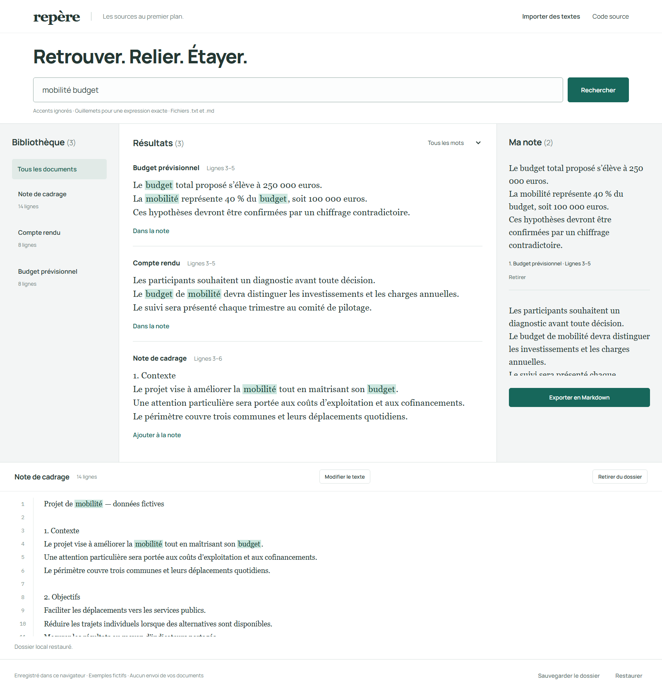
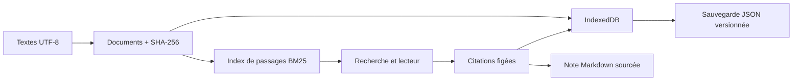

# Repère

### Les sources au premier plan.

Un espace de recherche documentaire local pour retrouver des passages, les comparer à leur source et assembler une note avec des références précises. Utile pour des études, des comptes rendus et des dossiers de projet.

[**Ouvrir Repère**](https://imtoocompedidiv.github.io/repere/) · [Architecture](#architecture) · [Vérifications](#vérifications)



## Parcours

1. Importer des fichiers texte ou Markdown UTF-8, ou explorer les trois exemples fictifs.
2. Rechercher avec tous les mots, au moins un mot, ou une expression exacte entre guillemets.
3. Ajouter un passage à la note. Son texte, ses lignes et l’empreinte de sa source sont conservés.
4. Modifier la source : les citations antérieures sont signalées au lieu d’être silencieusement réécrites.
5. Exporter une note Markdown avec références, ou sauvegarder le dossier JSON pour le restaurer ailleurs.

## Ce qui est implémenté

- Index par passages et classement BM25 ; recherche insensible à la casse et aux accents, filtres documentaires et contraintes d’expression exacte.
- Découpage conservant les numéros de lignes d’origine, lecteur avec surlignage et ouverture du passage source.
- Citations immuables avec empreinte SHA-256 ; détection des sources modifiées ou absentes.
- Stockage IndexedDB et sauvegardes JSON versionnées. Lors d’une restauration, les empreintes sont recalculées et les schémas validés.
- Export Markdown avec notes de référence et signalement des citations à revérifier.
- Éditeur de texte, recherche et export utilisables au clavier et sur mobile.

## Architecture



| Fichier                  | Responsabilité                                              |
| ------------------------ | ----------------------------------------------------------- |
| `src/core/search.ts`     | Tokenisation, passages, index et classement                 |
| `src/core/documents.ts`  | Empreintes, citations, validation des sauvegardes et export |
| `src/storage.ts`         | Transactions IndexedDB                                      |
| `src/DocumentViewer.tsx` | Lecture, sélection et modification                          |
| `src/NotePanel.tsx`      | Citations et export                                         |

## Développer

Node.js 22.12 ou supérieur compatible Vite 8.

```sh
npm ci
npm run dev
npm run check
npm run build
```

## Vérifications

8 tests vérifient les références de lignes, les accents, les expressions exactes, le classement, les changements de source, les empreintes de sauvegardes modifiées et les références exportées. La CI contrôle également TypeScript, le formatage et le build.

## Périmètre et données

Repère traite des textes `.txt` et `.md`, sans extraction PDF, OCR ni interprétation du HTML. Le Markdown importé est affiché comme texte, sans exécuter son contenu. Jusqu’à 40 documents de 500 Ko, un dossier importé de 2 millions de caractères, 200 citations et 100 résultats par recherche. Les mots sont comparés par forme normalisée, sans stemming ni recherche sémantique.

Les documents restent sur votre appareil ; GitHub Pages reçoit uniquement les requêtes habituelles d’hébergement du site. IndexedDB n’est pas chiffré par l’application et peut être effacé par le navigateur : exportez une sauvegarde pour conserver votre travail. Une empreinte détecte un changement de texte, elle ne certifie ni l’auteur ni la véracité d’un document. Les numéros de lignes renvoient à la version normalisée en sauts de ligne LF.

## Crédits

React, Vite, TypeScript et Vitest ; Manrope et IBM Plex Mono via Fontsource. Les exemples sont entièrement fictifs. Code sous licence MIT ; licences des dépendances conservées.
